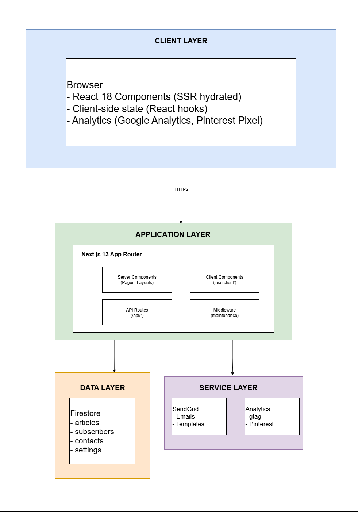
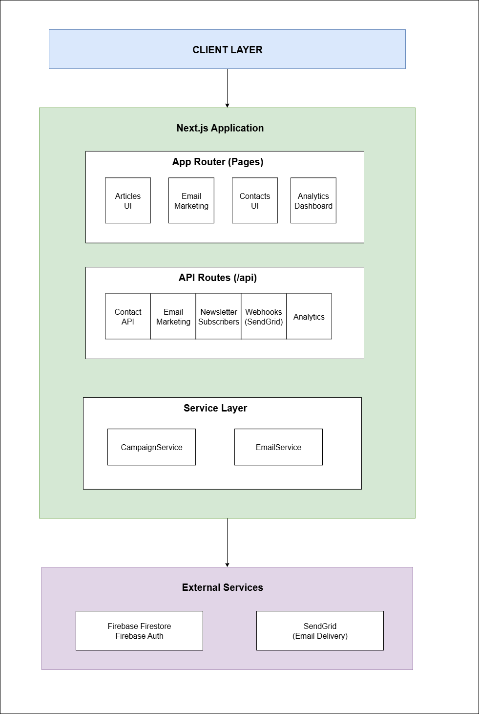

  

<h1 align="center">TroveTrends: Content Platform with Email Marketing & Admin Dashboard</h1>

---

> **This is a product showcase repository.** It contains documentation and architecture for TroveTrends, a proprietary content platform developed by [ByteUp LLC](https://byteup.co). The **public site is live at [trovetrends.com](https://trovetrends.com)**. Source code is not included. For licensing inquiries, see [Licensing](#licensing) below.

## About

**TroveTrends** is a production-grade, SEO-optimized content platform for technology, software, health, and lifestyle audiences, with integrated email marketing, lead generation, and affiliate infrastructure.

It ships as **two applications** working in concert:

1. **TroveTrends Frontend**: the public-facing content site at [trovetrends.com](https://trovetrends.com). Next.js 13.5 with App Router, SSR/ISR for SEO, Firebase Firestore for data, Resend for transactional email, a Ctrl+K search palette, trending articles, a Free Tools hub, and lead-capture flows.
2. **TroveTrends Admin**: the internal content management dashboard. Next.js 14 with Firebase Auth, article CRUD with a rich content-block system, email campaign management on Resend (with Svix-signed delivery webhooks), an ApexCharts analytics dashboard, and SEO metadata control. The admin app is at **v1.4.0** (its latest release in the changelog).

Live, deployed, and actively maintained on Vercel.

## Key Features

### Public Content Site

- **SEO-first architecture**: Server-side rendering and incremental static regeneration on every article and category page, structured data (JSON-LD) for rich snippets, dynamic sitemaps, RSS feeds
- **Command-palette search**: Ctrl+K / Cmd+K search dialog with article thumbnails, recent searches, and trending articles
- **Trending & Featured articles**: Dynamic trending content based on engagement metrics
- **Multi-category browsing**: Technology, software, health & lifestyle, finance & investing
- **Recipes subcategory**: Health & lifestyle recipe pages with click-to-load TikTok and Pinterest embeds (no third-party player loads until the reader asks for it), creator credit, and embed-view / outbound-click analytics
- **Free Tools hub**: `/tools`, home of the public Financial Health Calculator: spending plan, safety check, Money Psychology Score, and an action plan, linked from the finance category and articles
- **Newsletter subscription**: Double opt-in flow with confirmation and welcome emails via Resend
- **Contact form**: Rate-limited, validated, Firebase-stored with notification emails
- **Interactive quiz**: Lead-magnet quiz with result-driven content recommendations
- **Reading tracker**: Client-side engagement tracking for personalization signals
- **Popup lead magnets**: Newsletter popups triggered by time on page, scroll depth, or exit intent
- **Maintenance mode**: Built-in middleware for scheduled site maintenance windows
- **Secure PDF downloads**: JWT-protected PDF delivery for gated content
- **Error boundaries**: Fault isolation around the header, content, footer, and popups, plus a global error page
- **Security headers**: Content-Security-Policy, HSTS, and X-Frame-Options on every response
- **Accessibility**: WCAG AA color contrast target, focus traps, aria labels, and semantic HTML

### Admin Dashboard

- **Firebase Authentication**: Email/password and Google Sign-In
- **Protected admin API**: Firebase ID tokens verified on admin API routes, including campaign sends
- **Typed article model**: Articles are sequences of content blocks:
  - Headings, paragraphs, quotes, lists
  - Images with captions and alt text
  - Call-to-action buttons with affiliate tracking
  - Tables, embedded videos
- **Articles dashboard**: Status (draft, published, archived), view counts and affiliate clicks per article. The article editor's save path is in development.
- **SEO metadata**: Per-article meta title, description, Open Graph tags in the data model
- **Featured article designation**: Homepage hero and featured slots
- **Email Marketing**: Complete campaign management:
  - Email templates with brand-aligned design
  - Subscriber list management and segmentation
  - Campaign scheduling and analytics
  - Guarded status transitions (draft/scheduled → sending → completed/failed) written in a transaction
  - Archiving instead of deleting: archived campaigns keep their stats and an audit timestamp
  - Resend delivery events (opens, clicks, bounces, complaints) received through Svix-signed webhooks
- **Contact & lead management**: Subscriber and lead tracking with source attribution
- **Analytics dashboard**: ApexCharts KPIs: subscriber growth, campaign opens/clicks/delivered over time, engagement segments, top articles and affiliate clicks, with weekly and monthly comparisons
- **View count & affiliate click tracking**: Article-level engagement and revenue metrics

## Architecture

### Public Site

  

The frontend follows a clean four-layer architecture:

- **Client Layer**: React 18 components (SSR-hydrated) wrapped in error boundaries, client-side state via React hooks, Google Analytics and Pinterest Pixel for engagement tracking
- **Application Layer**: Next.js 13.5 App Router with Server Components (default) and Client Components (for interactive UI), API route handlers under `app/api/*`, middleware for maintenance mode and cross-cutting concerns
- **Data Layer**: Firebase Firestore (articles, newsletter subscribers, contacts, system settings) with a 5-minute in-memory query cache and security rules enforced at the database level
- **Service Layer**: Resend for transactional emails (confirmation, welcome, unsubscribe), analytics providers for engagement tracking

### Admin Dashboard

  

The admin dashboard uses Next.js 14 with Firebase Auth, the same Firestore collections as the frontend (read/write separation enforced by security rules), and Resend for campaign delivery. Resend posts delivery events back to a webhook route that checks the Svix signature before recording them.

*The architecture diagrams and PDFs below were drawn before the move from SendGrid to Resend; the text on this page is current.*

### Rendering Strategy

| Page Type        | Rendering | Reason                         |
| ---------------- | --------- | ------------------------------ |
| Article pages    | SSR + ISR | SEO optimization, fast loads   |
| Category pages   | SSR + ISR | SEO optimization               |
| Tools hub & calculator | SSR shell + client interactivity | Indexable page, interactive tool |
| Interactive quiz | CSR       | Client-side state management   |
| API routes       | Server    | Data operations                |

**Why this mix:** Content pages are SSR for SEO (crawlers get fully-rendered HTML), interactive features are CSR (no point in SSR for a calculator), and API routes run server-only to keep Firebase Admin SDK calls off the client bundle.

## Tech Stack

### Frontend (trovetrends.com)

| Category           | Technology                                    |
| ------------------ | --------------------------------------------- |
| Framework          | Next.js 13.5 (App Router, SSR/ISR)            |
| Language           | TypeScript 5.2 (strict mode)                  |
| Styling            | Tailwind CSS 3.3 + shadcn/ui (Radix primitives) |
| Icons              | Lucide React                                  |
| Database           | Firebase Firestore (Client SDK + Admin SDK)   |
| Email              | Resend (transactional)                        |
| Forms              | React state with server-side validation       |
| Data Visualization | Recharts, Embla Carousel                      |
| Testing            | Jest + ts-jest, live check scripts (bash)     |
| Deployment         | Vercel (standalone output)                    |

### Admin Dashboard

| Category           | Technology                                       |
| ------------------ | ------------------------------------------------ |
| Framework          | Next.js 14 (App Router), React 18                |
| Language           | TypeScript 5                                     |
| Styling            | Tailwind CSS + shadcn/ui                         |
| Auth               | Firebase Authentication (ID token verification)  |
| Database           | Firebase Firestore (Admin SDK, server-only writes) |
| Email              | Resend (campaigns, templates), Svix-signed webhooks |
| Charts             | ApexCharts                                       |
| Deployment         | Vercel                                           |

## Engineering Highlights

### SEO-First Architecture

Every public page is either SSR or ISR so that search engine crawlers receive fully-rendered HTML. Dynamic sitemaps are generated server-side from Firestore content. Structured data (JSON-LD) is emitted for articles, ensuring rich snippets in search results. The site ranks on Google for target keywords in health, finance, and technology verticals.

### Rate-Limited API Routes

The newsletter signup and contact form routes use an in-memory, per-IP fixed-window rate limiter. The gated PDF download route adds its own per-IP and per-email limits and counts how often each token is used.

### Double Opt-In Newsletter Flow

Newsletter subscription uses a verified double opt-in pattern:

1. User submits email → server validation (format + duplicate check)
2. Subscriber created in Firestore with `pending` status + confirmation token
3. Confirmation email dispatched via Resend with tokenized link
4. User clicks link → status updated to `confirmed`, welcome email sent

This ensures only real, owned email addresses enter the subscriber base, which is critical for deliverability and CAN-SPAM compliance.

### Content Block System

Articles aren't stored as raw HTML or Markdown. Instead, each article is a structured sequence of **content blocks** (heading, paragraph, image, CTA, table, list, quote, embed) with typed metadata. The data schema stays consistent and machine-readable, and an editor can offer one control per block type.

**Why this matters:** A future headless API, mobile app, or AI summarizer can walk the block structure without parsing HTML.

### JWT-Protected PDF Downloads

Gated PDF content (lead magnets, ebooks) is served through a JWT-token-based download flow. The token is generated server-side with a short expiry, bound to the requesting user or form submission, and validated before serving the file. Prevents hotlinking and enforces gating.

### Firestore Security Rules

Firestore security rules validate every client create (required fields, types, email format, a recent timestamp, an allowed source, and length limits). They restrict client updates to a few fields, and block client deletes and collection listing. Privileged writes go through the Admin SDK on the server.

### Email Campaign Lifecycle (Admin)

Campaign status changes go through one service method with an allowed-transition guard, run inside a Firestore transaction: draft or scheduled → sending → completed or failed, and anything not currently sending → archived. Deleting a campaign archives it and stamps `deletedAt`, so stats and the audit trail survive. Archived, sending, and completed campaigns cannot be edited, and the send route requires a verified Firebase ID token.

### Privacy-Friendly Embeds

Recipe pages show a static placeholder until the reader clicks. Only then does the TikTok or Pinterest player load, so third-party scripts and trackers don't run on every page view. The Content-Security-Policy `frame-src` allows only the site itself plus the TikTok and Pinterest embed hosts.

### Live Check Scripts

Besides unit tests, bash live-check scripts exercise the built site the way a visitor would (canonical URLs, the Tools hub, recipe pages, the sitemap). An orchestrator runs them all against a local production build.

### Performance Optimizations

- **SWC minification** for faster builds and smaller bundles
- **`next/image`** with automatic format negotiation and responsive sizing
- **Standalone output** for containerized deployments
- **Server Components by default** to reduce client-side JavaScript
- **Dynamic imports** for heavy components (calculator, quiz, charts)
- **Static generation** where content is stable
- **5-minute in-memory cache** for Firestore queries, alongside ISR for pages
- **Click-to-load embeds** so third-party players load only on demand

## By the Numbers

| Metric                    | Value                                              |
| ------------------------- | -------------------------------------------------- |
| Apps                      | 2 (Public site + Admin dashboard)                  |
| API Route Handlers        | 12+ (frontend) + full admin API                    |
| Firestore Collections     | `articles`, `newsletter_subscribers`, `contacts`, `systemSettings`, `subscribers_campaigns` |
| Email Templates           | Confirmation, Welcome, Unsubscribe, Campaign templates (Resend) |
| Free Tools                | Financial Health Calculator                        |
| Article Block Types       | 8+ (heading, paragraph, image, CTA, table, list, quote, embed) |
| Admin Auth                | Firebase Auth, ID tokens verified on admin API routes |
| Versions                  | Frontend 1.0.0 · Admin 1.4.0                       |
| Deployment                | Vercel (production + preview environments)         |

## Documentation

Full architecture documentation is included as downloadable PDFs:

- [**TroveTrends Frontend Architecture**](docs/TroveTrends_Frontend_Architecture.pdf): 9-page deep-dive covering technology stack, system architecture, directory structure, data flow, state management, rendering strategy, external integrations, and performance
- [**TroveTrends Admin Architecture**](docs/TroveTrends_Admin_Architecture.pdf): Admin dashboard architecture, authentication flow, article management design, database schema, deployment guide

*The PDFs predate the Resend migration and still mention SendGrid.*

The internal documentation library also includes:

- Component reference
- API reference
- Security model
- Development guide
- Deployment guide
- Database schema
- Article management design

## Security

### Authentication (Admin)

- Firebase Authentication (email/password + Google OAuth)
- Firebase ID token verification on admin API endpoints
- Secure session management

### Data Protection

- **Firestore security rules** validate every client create, restrict client updates to a few fields, and block client deletes
- Privileged writes go through the Admin SDK, which runs only in Next.js API routes
- Resend webhooks verified by Svix signature before any event is stored
- Environment variables for all API keys (never in client bundles)

### API Hardening

- In-memory per-IP rate limiting on the newsletter and contact routes; per-IP and per-email hourly limits on PDF downloads, counted in Firestore
- Content-Security-Policy, HSTS, and X-Frame-Options security headers
- Input validation at client, API, and database layers
- CAN-SPAM compliant unsubscribe flow
- HTTPS-only production traffic via Vercel

## Skills Demonstrated

| Area                  | Details                                                                    |
| --------------------- | -------------------------------------------------------------------------- |
| Full-Stack Next.js    | App Router, SSR/ISR, Server Components, middleware, API routes             |
| SEO Engineering       | Structured data, sitemaps, RSS, meta tags, SSR-first architecture         |
| Firebase              | Firestore (Client + Admin SDK), Auth with ID token verification, security rules |
| Email Infrastructure  | Resend transactional + campaigns, Svix-signed webhooks, double opt-in, unsubscribe |
| Auth & Security       | Firebase ID token verification, CSP/HSTS headers, Firestore rules          |
| Form Handling         | Rate-limited submission, server validation                                |
| Content Architecture  | Block-based content model, typed schemas, headless-API-ready data         |
| Performance           | SSR + ISR, dynamic imports, image optimization, SWC, caching strategy     |
| DevOps                | Vercel deployment, standalone output, environment management              |
| Testing               | Jest, ts-jest, component testing, live check scripts                      |
| Accessibility         | WCAG AA contrast target, focus traps, aria labels, semantic HTML           |
| Data Visualization    | ApexCharts analytics dashboard                                            |
| Documentation         | Architecture PDFs, API references, component docs, security model         |

## About ByteUp

TroveTrends is a product of **[ByteUp LLC](https://byteup.co)**, a software studio building SaaS products for underserved markets and delivering contract development for clients who value clean architecture and reliable code.

### ByteUp products

| Product                   | Status             | Link                                                                                        |
| ------------------------- | ------------------ | ------------------------------------------------------------------------------------------- |
| **TroveTrends**           | Live               | You are here · [trovetrends.com](https://trovetrends.com)                                   |
| **FixDoc**                | Private beta       | [fixdoc-showcase](https://github.com/ivansing/fixdoc-showcase): Document checks for mortgage loan files |
| **Migratex**              | Production-ready   | [migratex-showcase](https://github.com/ivansing/migratex-showcase): Excel → PostgreSQL ETL CLI |
| **Stripe Payment Links**  | Production-ready   | [stripe-payment-links-showcase](https://github.com/ivansing/stripe-payment-links-showcase): FastAPI payment API |

### Author

Built and maintained by **Ivan Duarte**, Full-Stack Software Engineer and founder of ByteUp LLC. Based in Bogotá, Colombia.

- Company: [byteup.co](https://byteup.co) · contact@byteup.co
- GitHub: [@ivansing](https://github.com/ivansing)
- LinkedIn: [lance-dev](https://linkedin.com/in/lance-dev)

## Licensing

TroveTrends is proprietary software developed by ByteUp LLC. The source code of both the frontend and admin applications is not included in this repository and is not available under any open-source license. The live site at trovetrends.com is publicly accessible for content, but the underlying code and admin dashboard are not.

This repository contains documentation and marketing materials only. The content (README, architecture documentation, diagrams, PDFs) is provided for informational and portfolio purposes.

**For commercial licensing, white-label inquiries, or custom content-platform development, contact contact@byteup.co.**

---

*Document Version: 1.1 · Product: TroveTrends · Status: Live at [trovetrends.com](https://trovetrends.com)*
